<div align="center">

# 🥊 BNB CLASHES 🏁🔫🎲🕵️

### Fight · Race · Shoot · Play — *one office.*

**Five games starring the whole Bit & Bytes team.** Punch your way up to the CEO, drift through downtown at rush hour,
hold the office in a team deathmatch, roll for a six on the boardroom table, and find out who in the office is *Mafia*.

[**▶ Play in your browser**](https://abdulwasay-bnb.github.io/bnb-clashes/) &nbsp;·&nbsp;
[**⬇ Download (Android · iPhone · Windows · Linux)**](https://github.com/Abdulwasay-bnb/bnb-clashes/releases/latest)

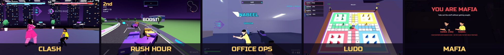

</div>

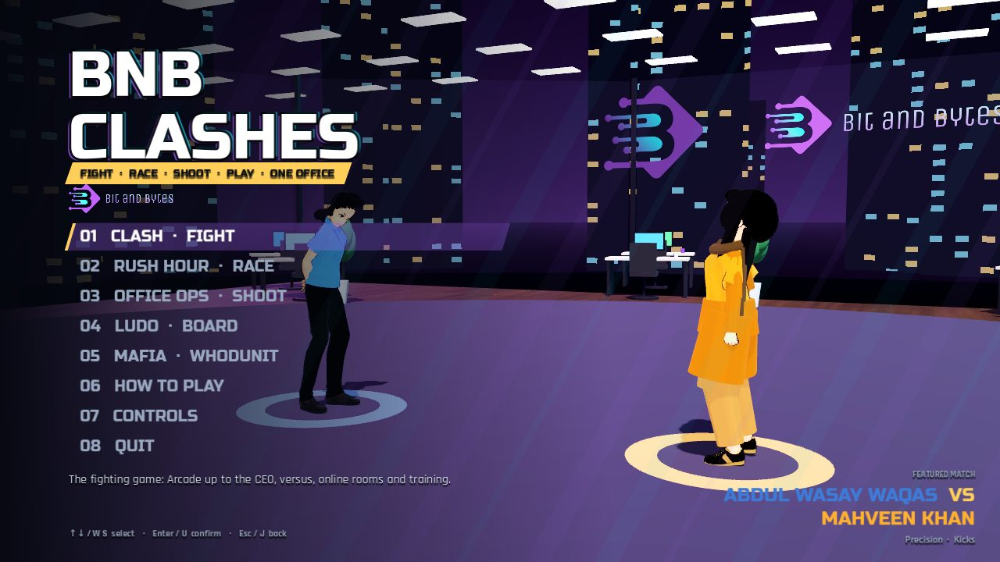

---

## 🎮 The games

| | Game | What it is | Players |
|---|---|---|---|
| 🥊 | **Clash** | 3D office fighter: Arcade up to the CEO, Versus, Online, Training | 1–2 |
| 🏁 | **Rush Hour** | 10-car combat street race with items, nitro and signature powers | 1–10 |
| 🔫 | **Office Ops** | First-person team deathmatch, 1v1 up to 4v4 | 1–8 |
| 🎲 | **Ludo** | The classic, on a 3D board on the boardroom table | 1–4 |
| 🕵️ | **Mafia** | Office whodunit: do your tasks, report bodies, vote out the killer | 4–10 |

Every game runs on **desktop, phones (full touch controls) and the browser**, and every multiplayer game fills empty seats with CPU players.

---

## 🥊 Clash — the office fighter

Every fighter is someone from the team, every arena is our office, and at the top of the ladder waits the CEO.

<table>
<tr>
<td width="50%">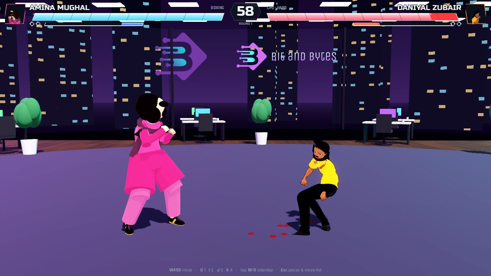</td>
<td width="50%">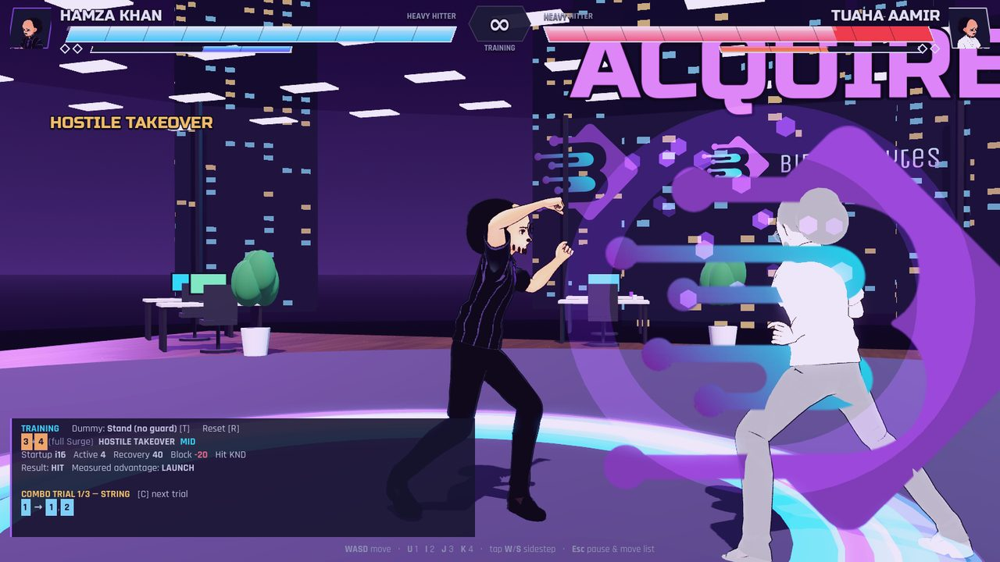</td>
</tr>
<tr>
<td><sub>Frame data, strings, juggles, throws and sidesteps, with motion-captured strikes.</sub></td>
<td><sub>Every person has their own Surge Art. Here the CEO announces a <i>hostile takeover</i>.</sub></td>
</tr>
<tr>
<td>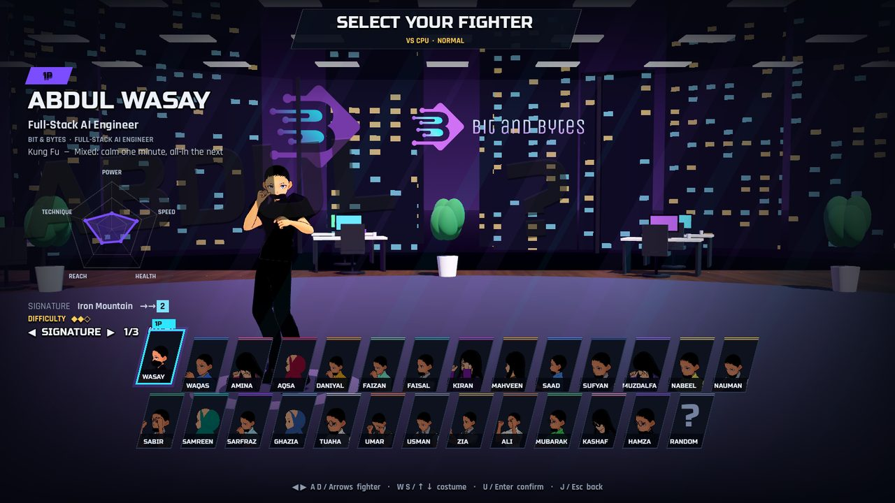</td>
<td>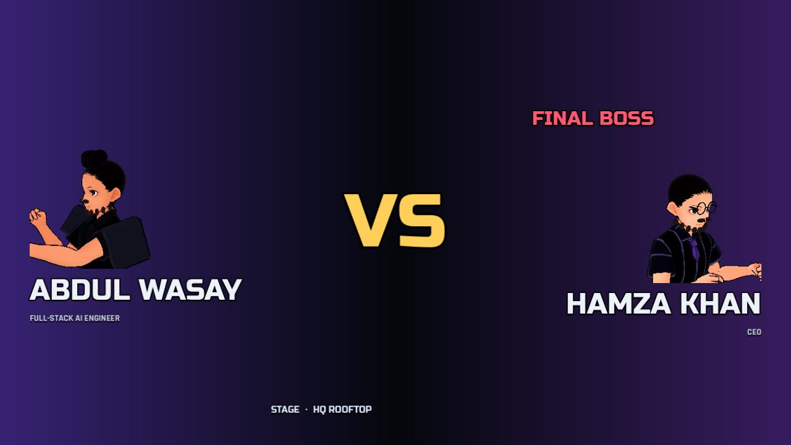</td>
</tr>
<tr>
<td><sub>26 colleagues, 3 outfits each, their own colours, voice, quote and fighting style.</sub></td>
<td><sub>The final boss. More health, harder hits, a boss-level CPU and an aura.</sub></td>
</tr>
</table>

**Arcade ladder:** four colleagues → **Kashaf ud Duja** *(HR, mini boss)* → **Muhammad Mubarak** *(PM, bonus boss)* → **Hamza Khan** *(CEO, final boss)*.
**Arenas:** Open Office · Server Room · Boardroom · Cafeteria · HQ Rooftop.

### 🏆 Beat the CEO, get certified

Clear Arcade and you're issued an official-looking *(entirely unofficial)* certificate, saved as an image or PDF.

<div align="center">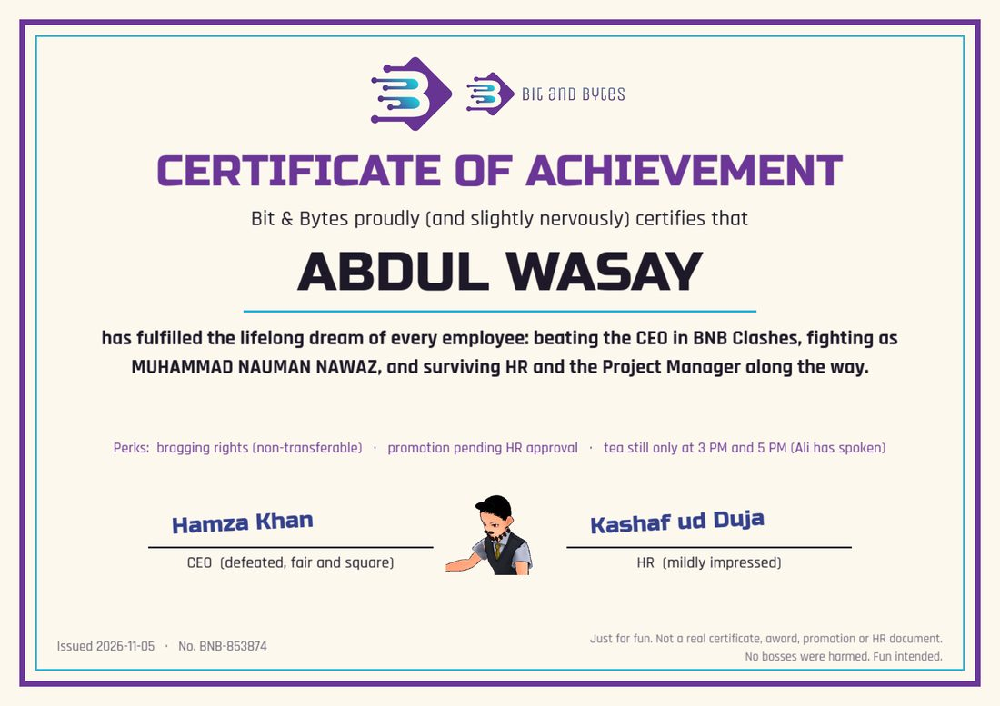</div>

---

## 🏁 Rush Hour — combat racing

Ten cars, three laps, zero respect for traffic laws. Grab a pickup, throw it at whoever's ahead, then unleash your
character's power when the meter fills.

<table>
<tr>
<td width="50%">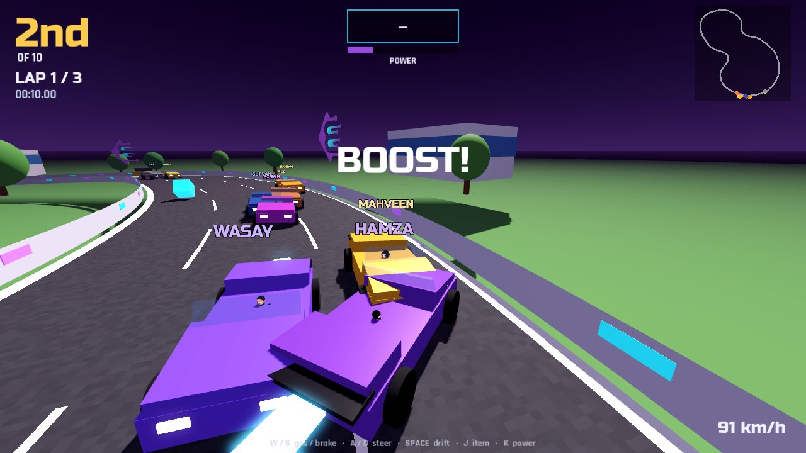</td>
<td width="50%">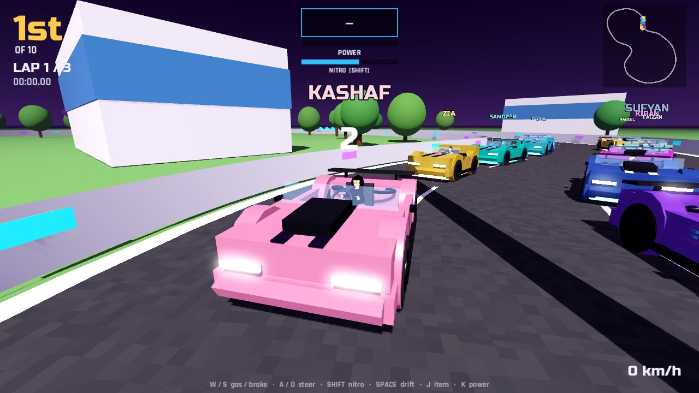</td>
</tr>
</table>

- **Three tracks:** Downtown Loop (neon towers and night traffic), Office Park (a hill with a jump), Rooftop Circuit (thirty storeys up at sunset)
- **Pickups:** homing staplers, paper-plane volleys, coffee spills, banana peels, energy drinks
- **Driving:** drift boosts, a nitro tank, jumps, and hits that slow you down rather than spin you out
- **Cars:** sports, muscle and hatchback bodies with stripes, spoilers, underglow and a flame on boost

---

## 🔫 Office Ops — team deathmatch

First-person TDM on the office floor: glass meeting rooms, cubicles, server racks.

<table>
<tr>
<td width="50%">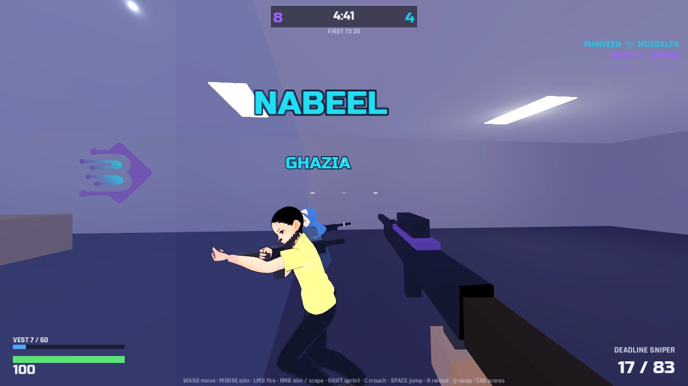</td>
<td width="50%">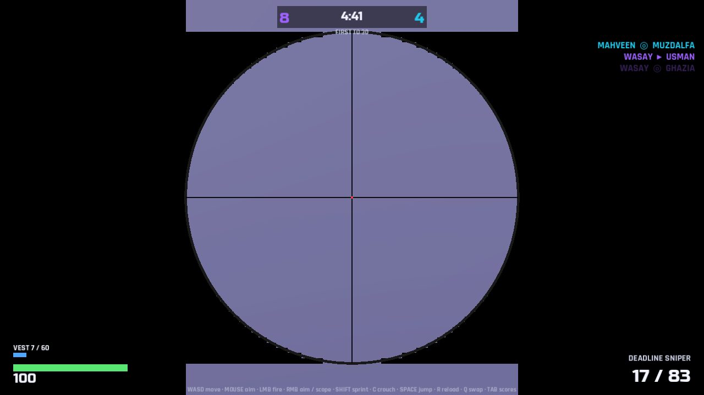</td>
</tr>
</table>

- **Five guns:** KPI-47 Rifle, Sprint SMG, Breakroom Shotgun, Deadline Sniper (with a real scope), plus a P-9 pistol
- **Vests:** each character carries a different vest (40–100). It soaks 60% of the damage until it breaks, except headshots
- **Movement:** aim down sights, sprint, crouch, jump onto desks; damage drops off with range
- **Team sizes:** 1v1, 2v1, 3v4, 4v4… any mix, with bots on easy, normal or hard

---

## 🎲 Ludo — on the boardroom table

<div align="center">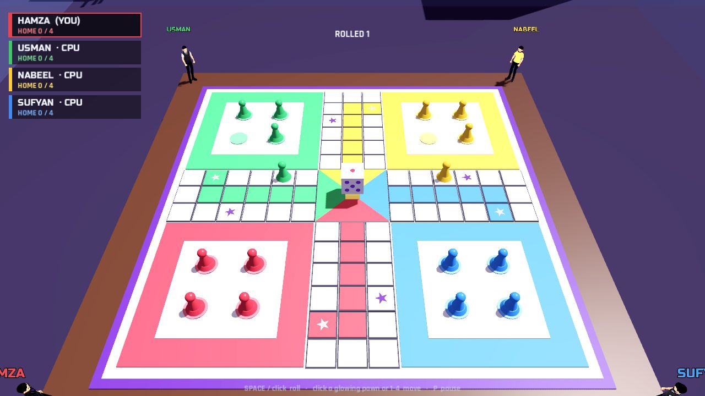</div>

A 3D board, pawns that hop square by square, and a die that actually tumbles. Your character stands at your corner
and **cheers your captures** (or sulks when you send them home). Play vs 1–3 CPU, **pass & play** on one device, or with friends online.

*A 6 brings a pawn out · land on a rival to send it home · stars and start squares are safe · three 6s in a row lose the turn · exact roll to finish.*

---

## 🕵️ Mafia — who did it?

Somebody in the office has a knife. **Staff** do their tasks and try to survive; the **Mafia** blend in, cut the
power and take people out one by one. Find a body, hit **REPORT**. Something feels off, hit the big red **ALERT** button.
Everyone sits at the boardroom table to **chat and vote someone out**.

<table>
<tr>
<td width="50%">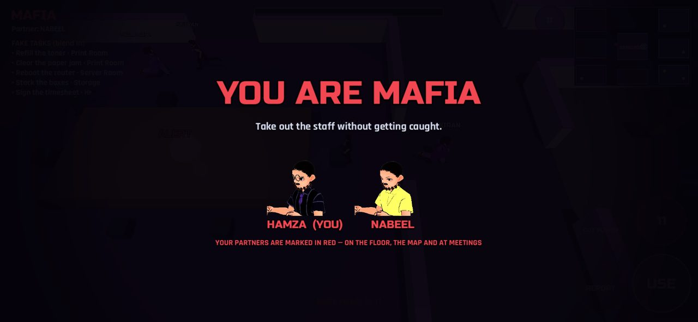</td>
<td width="50%">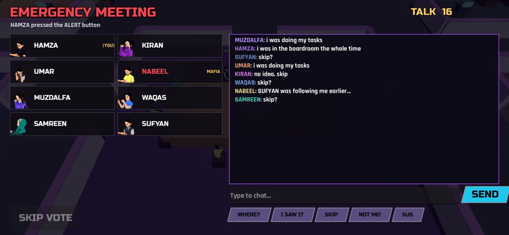</td>
</tr>
<tr>
<td><sub>The role reveal. Mafia partners see each other here, in red on the floor, on the map and at meetings.</sub></td>
<td><sub>Meetings: typed chat plus quick-chat buttons, then a vote. The fired person's role can be revealed.</sub></td>
</tr>
<tr>
<td>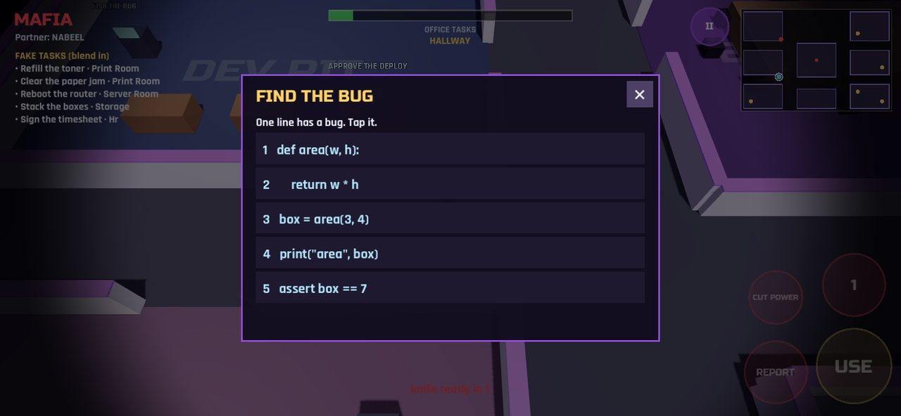</td>
<td>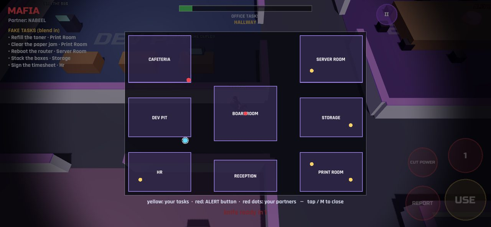</td>
</tr>
<tr>
<td><sub>Nine kinds of office task: brew the coffee, find the bug, patch the cables, clear the paper jam, sort the mail…</sub></td>
<td><sub>An always-on minimap; tap it for the full floor plan with your tasks.</sub></td>
</tr>
</table>

- **8 rooms:** Cafeteria, Dev Pit, HR, Server Room, Storage, Print Room, Boardroom, Reception
- **Limited vision.** During a **power cut** staff can barely see until someone fixes the fuse box
- **Ghosts** keep finishing their tasks, with their own ghost chat
- **Smart bots:** they do tasks, report bodies, witnesses speak up, and the Mafia stalk lone targets and talk their way out
- **Staff win** when every task is done or the Mafia are gone. **Mafia win** when they match the staff in number

---

## 🌐 Play together

<div align="center">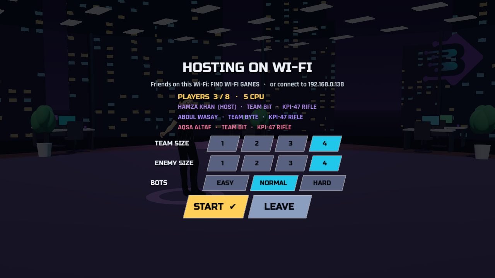</div>

- **Online rooms:** the host gets a 5-letter code and friends type it in. Works over the internet.
- **Same Wi-Fi:** no internet needed. Friends find your game automatically.
- **CPU fill:** missing players are replaced by CPU drivers, bots or CPU Ludo players. If someone drops mid-game, a CPU takes over.

**How it works:** the matches run **peer-to-peer**. The host's game runs the match and streams it to everyone (WebRTC
online, WebSockets on Wi-Fi). The tiny room server in [`server-vercel/`](server-vercel) (Vercel edge functions + Redis)
only hands out room codes and passes the connection handshake. Game data and chat never go through it. In Mafia the
host only tells each player their *own* role.

---

## 📱 Made for phones too

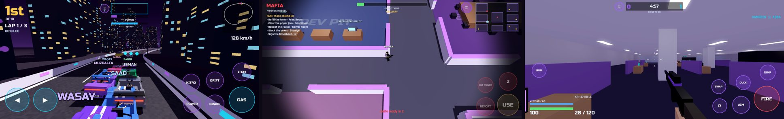

On-screen sticks, buttons and a pause button in every mode, with layouts tuned so nothing sits under your thumbs.

---

## 🛠️ For developers

Built with **Godot 4.7** (GL Compatibility renderer). The games share the same 3D characters and animation system.

```bash
./run.sh                        # play from source
./build_android.sh              # → build/android/BNBClashes.apk
./build_desktop.sh              # → build/BNBClashes-windows.zip, build/BNBClashes-linux.zip
./build_ios.sh                  # → Xcode project; the "iOS build" GitHub workflow turns it into an .ipa
./deploy_pages.sh               # → web version on GitHub Pages
```

| Folder | What's inside |
|---|---|
| `scripts/` | Clash fighter, UI, online 1v1 (`net.gd`), party play for the other games (`party.gd`, `party_lobby.gd`) |
| `scripts/race/` · `scripts/ops/` · `scripts/ludo/` · `scripts/mafia/` | Each game: a rules simulation (`*_sim.gd`) and its view (`*_game.gd`) |
| `server-vercel/` | Room-code and handshake server (Vercel) |
| `data/bnb_roster.json` | The roster: everyone's role, style, colours, outfits, powers and quotes |

**Testing:** every mode has headless and rendered autotests, e.g. `--autotest=racesim`, `opssim`, `ludosim`, `mafiasim`,
and multi-process online tests (`partyhost` / `partyjoin`).

**The roster** is generated from a private team sheet (kept out of the repo) with `tools/gen_roster.py`. Each person is
built on one of 8 base fighting styles, with their own name, role, colours, three outfits, height, Surge Art and quote.
Fighters are original stylised characters; no photos or likenesses are used.

---

## 🙏 Credits

Company logo © Bit & Bytes. Engine, models and animation credits: see [`CREDITS.md`](CREDITS.md).
Animations from Mixamo are used in the builds but not redistributed in this repository.

<div align="center"><sub>Just for fun. No bosses were harmed. 🧡</sub></div>
